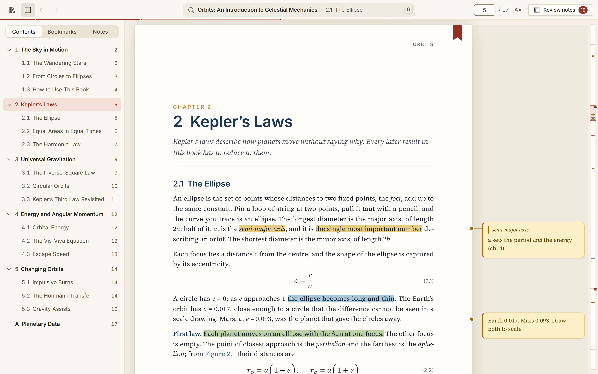
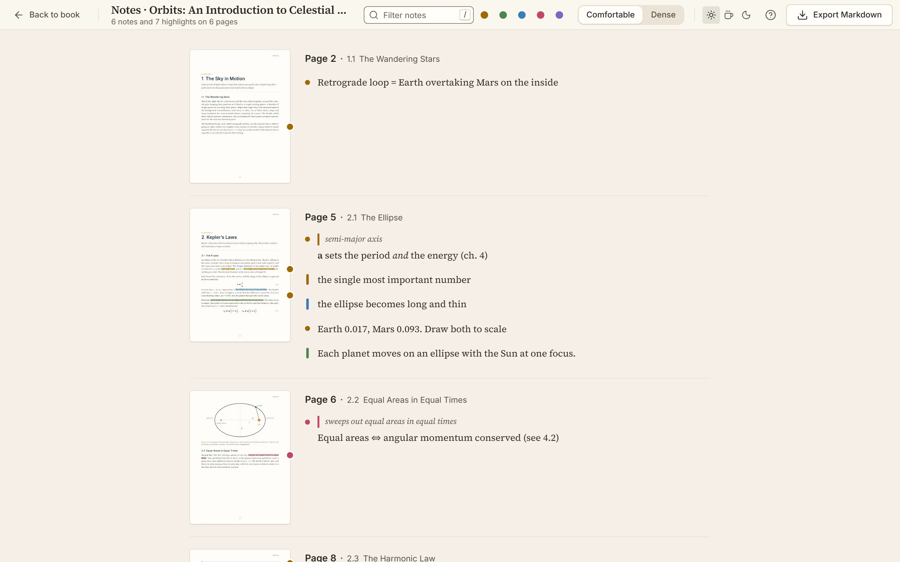
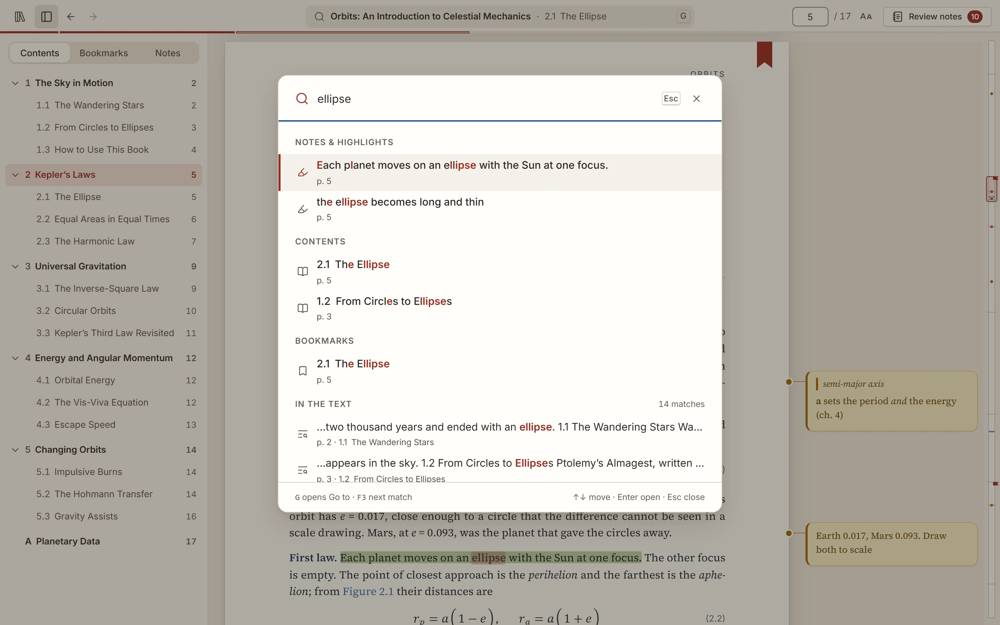
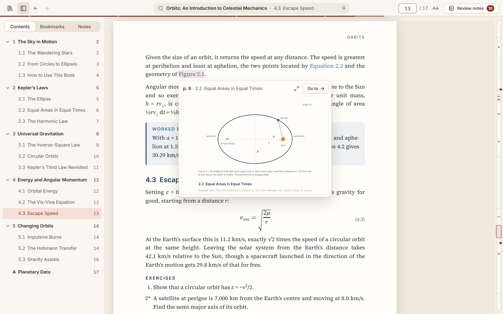
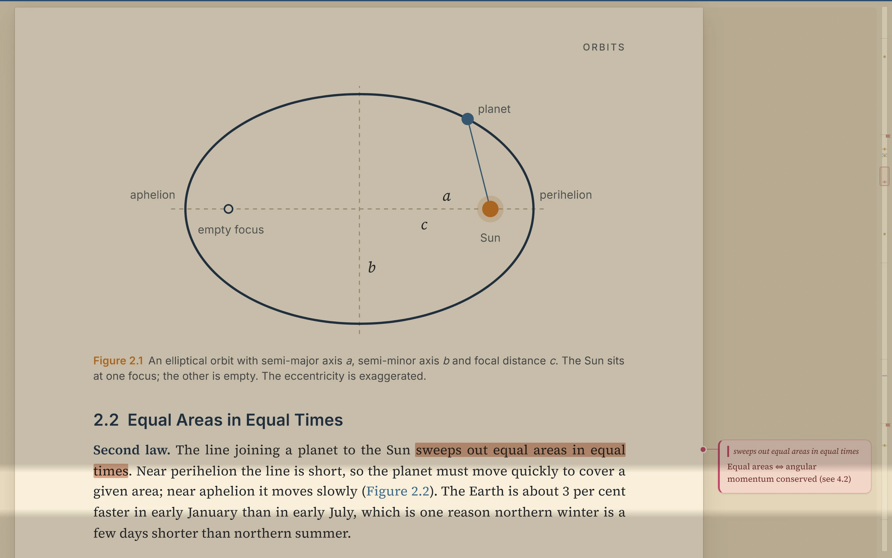
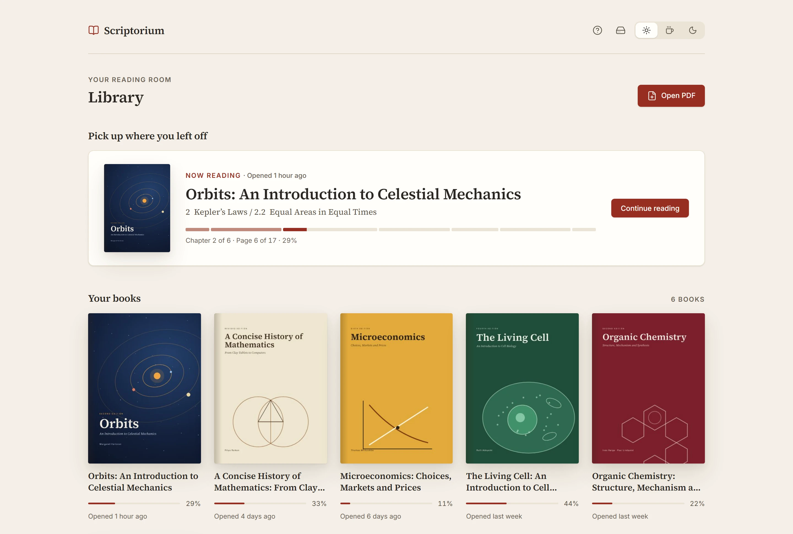

<p align="center">
  
</p>

<h1 align="center">Scriptorium</h1>

<p align="center">
  A PDF reader that you actually <i>want</i> to use.<br>
  Optimized for textbooks and long-form content.<br>
  Write in the margins, collate and review your notes, track your progress, and navigate your documents seamlessly. 
</p>

<p align="center">
  <a href="https://github.com/Kevin-Taha/Scriptorium/actions/workflows/ci.yml"></a>
  <a href="LICENSE"></a>
</p>



Scriptorium runs in your browser and installs as an app. There's no account and no server: your
books and notes stay on your devices, or in a folder you choose ([how data is stored](docs/DATA.md)).

## Margin notes and highlights

Click beside a passage to write a note level with it, or select text and press <kbd>N</kbd> to quote
it. Highlight in one of five colours and attach a note to any highlight. Notes never overlap, take
bold and italics, and save as you type.

## Review your notes

<kbd>Shift</kbd>+<kbd>R</kbd> lays out every annotated page with its thumbnail, notes and highlights.
Filter by colour or text, edit in place, and export to Markdown.



## Go to anything

Press <kbd>G</kbd> and type a page number, a chapter, a bookmark, words from your notes or anything
in the text. Printed page numbers work, roman numerals included.



## Peek at references

Hover a link like "see Figure 2.1" to preview it without leaving your page. When you do jump, a
*Return to p. N* pill takes you back.



## Focus mode and themes

<kbd>F</kbd> hides everything but the page, and <kbd>R</kbd> adds a reading ruler. Light, sepia and
dark themes, with optional page inversion for reading at night.



## Your library

Covers, progress, and your place saved as you read. Link a folder of PDFs, on your computer or in
OneDrive, Google Drive or Dropbox, and every computer that links it shares the same books, notes
and progress.



## Also

- **Book map:** a strip along the right edge marking chapters, notes and bookmarks; hover to preview.
- **Chapter progress:** a hairline under the toolbar that fills as you read.
- **Bookmarks:** click the ribbon on a page or press <kbd>B</kbd>.
- **Long books:** pages render as you reach them, so 1,000-page textbooks stay quick.
- **Backups:** export everything to one file and restore it anywhere.
- **Offline:** once installed, your library opens without a connection.

## Keyboard shortcuts

Press <kbd>?</kbd> in the app for the full list.

<details>
<summary>The ones you'll use most</summary>

| Shortcut | Action |
| --- | --- |
| <kbd>G</kbd> | Go to a page, chapter, bookmark or note, or run an action (`#N` for a PDF page number) |
| <kbd>Ctrl</kbd>+<kbd>F</kbd> or <kbd>/</kbd> | Find in the book; <kbd>F3</kbd> / <kbd>Shift</kbd>+<kbd>F3</kbd> step through matches |
| <kbd>N</kbd> | New margin note on the current page, quoting any selected text |
| <kbd>H</kbd> | Highlight the selected text in the colour used last |
| <kbd>B</kbd> | Bookmark the current page |
| <kbd>Shift</kbd>+<kbd>R</kbd> | Open or close the notes review |
| <kbd>F</kbd> | Focus mode (<kbd>Esc</kbd> also leaves) |
| <kbd>R</kbd> | Reading ruler |
| <kbd>[</kbd> | Show or hide the sidebar |
| <kbd>Alt</kbd>+<kbd>←</kbd> / <kbd>Alt</kbd>+<kbd>→</kbd> | Back / forward through jumps |
| <kbd>+</kbd> / <kbd>-</kbd> / <kbd>0</kbd> | Zoom in / zoom out / fit width |
| <kbd>Ctrl</kbd>+<kbd>B</kbd> / <kbd>Ctrl</kbd>+<kbd>I</kbd> | Bold / italic while writing a note |
| <kbd>Esc</kbd> | Leave focus mode, dismiss the return pill or close a menu |

</details>

## Run it

Scriptorium uses [Bun](https://bun.sh), a single install that provides the runtime, package
manager and script runner:

```sh
# Windows (PowerShell)
powershell -c "irm bun.sh/install.ps1 | iex"
# macOS / Linux
curl -fsSL https://bun.sh/install | bash
```

Then, from the repository:

```sh
bun install
bun run dev
```

Open the printed local address and drop a PDF onto the library. To install it as an app, use your
browser's install button in the address bar, or **Install app** in the library when it appears.

## Development

| Command | Description |
| --- | --- |
| `bun run dev` | Start the development server |
| `bun run build` | Type-check and build for production into `dist/` |
| `bun run preview` | Serve the production build locally |
| `bun run check` | Type-check, lint, check formatting, unit test and build |
| `bun run lint` / `bun run format` | Lint / format the code (Biome) |
| `bun run test` | Run unit tests (Vitest) |
| `bun run e2e` | Run end-to-end tests (Playwright) against the production build |
| `bun run fixture` | Generate the synthetic textbook used by the end-to-end tests |

The first end-to-end run needs a browser: `bunx playwright install chromium`.

### Architecture

Scriptorium is a single-page React application built with Vite and TypeScript. PDFs are rendered
with [pdf.js](https://mozilla.github.io/pdf.js/) by a custom virtualized viewer that lays each page
out beside its margin column.

```
src/
  app/          App shell, hash router, settings and theming
  components/   Shared UI primitives (toasts)
  features/
    library/    Library screen and PDF import
    reader/     Reader shell, viewer engine, zoom, link peek
    navigation/ Jump history, return pill, bookmarks, outline, page labels, chapter progress, shortcuts
    palette/    Go to: pages, chapters, bookmarks, notes and actions in one box
    bookmap/    The book map along the reader's right edge
    focus/      Focus mode and the reading ruler
    notes/      Margin notes (bold/italic editing), collated review, Markdown export
    search/     Full-text index and in-page highlights
    settings/   Library & storage: linked folder, backups, persistent storage
    sync/       Folder sync engine
  lib/
    pdf/        pdf.js loading, destinations and outline, thumbnails
    storage/    IndexedDB schema and repository
    sync/       Backup format, merging and device identity
  styles/       Design tokens and base styles
docs/           Roadmap, data and sync model, design spec, README images
e2e/            Playwright end-to-end tests
scripts/        Development scripts (test fixture generator)
```

All persistence goes through `src/lib/storage/repository.ts`, which keeps the door open for a
filesystem-backed store in a future desktop build. State lives in small
[Zustand](https://github.com/pmndrs/zustand) stores per feature.

The production build ships a strict Content-Security-Policy (`contentSecurityPolicy` in
`vite.config.ts`): scripts, styles, fonts and workers come only from the app's own origin, and
runtime styles go through constructed stylesheets rather than `<style>` elements.

See [`docs/ROADMAP.md`](docs/ROADMAP.md) for what's next, [`docs/DATA.md`](docs/DATA.md) for how
data is stored and synced, and [`docs/DESIGN.md`](docs/DESIGN.md) for the design system.

## License

[MIT](LICENSE)
